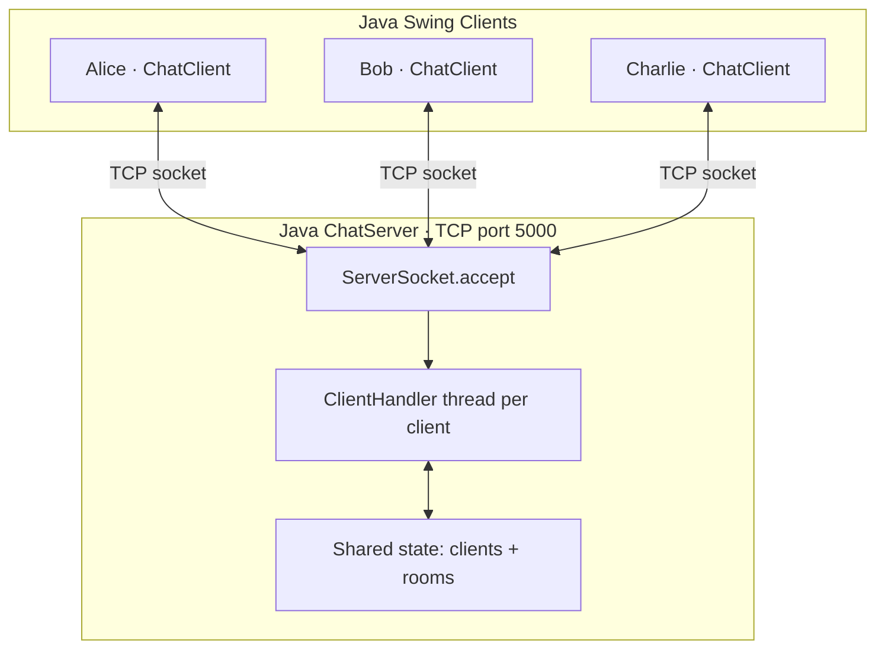
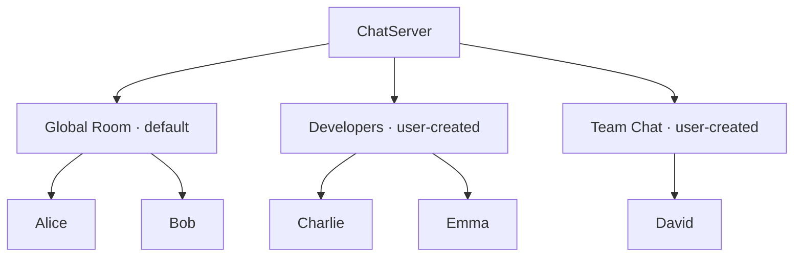
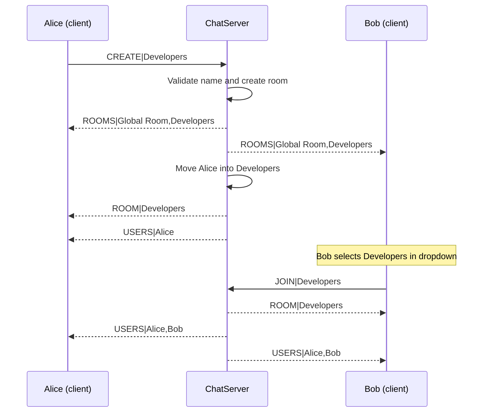
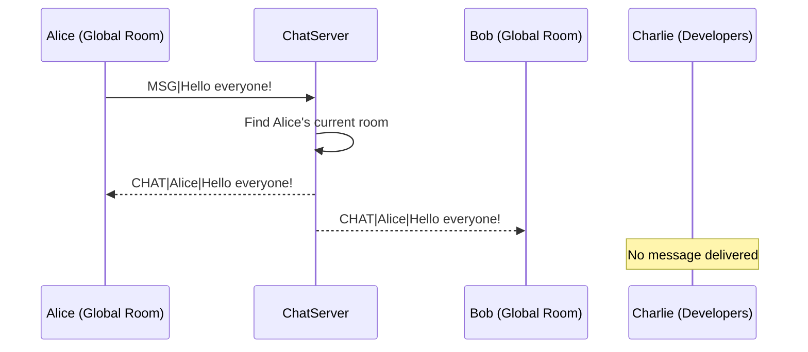

# Java Swing Multi-Client Chat Application

A desktop group-chat application built with **Java Swing**, **TCP sockets**, and **one multithreaded server**. Multiple clients can chat concurrently, create chat rooms, and switch between rooms. Every new client joins **Global Room** by default.

> **Package:** `org.vb.chatbot`  
> **Java version:** 11 or newer  
> **Server port:** `5000`  
> **Dependencies:** Java standard library only

## Features

- One TCP server handles multiple clients simultaneously (one handler thread per connection).
- Java Swing desktop interface with message area, input field, Send button, room dropdown, **Create Room** button, and room-specific online-user list.
- New users automatically join **Global Room**.
- Users can create named rooms; new rooms appear in every connected client's dropdown.
- Users can switch rooms at any time; chat messages reach only members of the sender's current room.
- Room membership updates and join/leave notifications.
- Duplicate usernames and invalid room names are rejected.

## Architecture



The server owns room membership. Clients send simple line-based commands; the server sends room lists, user lists, notices, and chat messages back to clients.

## Room structure



**Example:** Alice's message in Global Room is delivered to Alice and Bob, but not to Charlie, Emma, or David. A user belongs to **one room at a time** in this implementation.

## UI overview

```text
+-----------------------------------------------------------------------+
| Java Chat - Alice - Global Room                                       |
+-----------------------------------------------------------------------+
| Room: [ Global Room                 v ] [ Create Room ]                |
+-----------------------------------------------+-----------------------+
| [Server] You are now in Global Room            | Users in room         |
| [Server] Bob joined the room.                  |                       |
| Alice: Hello!                                 | Alice                 |
| Bob: Hi Alice!                                | Bob                   |
|                                               |                       |
+-----------------------------------------------+-----------------------+
| Connected to localhost:5000                                           |
| [ Type a message...                              ] [ Send ]            |
+-----------------------------------------------------------------------+
```

## Project structure

```text
JavaSwingChatRooms/
├── README.md
└── src/
    └── main/
        └── java/
            └── org/
                └── vb/
                    └── chatbot/
                        ├── ChatServer.java
                        └── ChatClient.java
```

Both Java files declare `package org.vb.chatbot;`.

## Build and run

From the **project root** (the folder containing `src`):

### 1. Compile

**macOS / Linux**

```bash
javac -d out src/main/java/org/vb/chatbot/*.java
```

**Windows PowerShell**

```powershell
javac -d out src/main/java/org/vb/chatbot/ChatServer.java src/main/java/org/vb/chatbot/ChatClient.java
```

### 2. Start the server

```bash
java -cp out org.vb.chatbot.ChatServer
```

Expected output:

```text
Chat server listening on port 5000
```

### 3. Start a client

Open **another terminal** in the same project root:

```bash
java -cp out org.vb.chatbot.ChatClient
```

Enter `localhost` for the server address and a username such as `Alice`. Run the client command from additional terminals for `Bob`, `Charlie`, etc. Each client opens its own Swing window.

### 4. Connect from another computer

Both computers must be able to reach each other (for example, on the same LAN). In the client startup dialog, enter the **server computer's LAN IP address** instead of `localhost`. Ensure TCP port `5000` is allowed through the server's firewall. The application has no TLS or authentication; **do not expose it directly to the public internet**.

## How connections work

```mermaid
sequenceDiagram
    participant U as User
    participant C as ChatClient (Swing)
    participant S as ChatServer
    U->>C: Launch and enter server + username
    C->>S: Connect TCP to port 5000
    C->>S: username (first line)
    alt Username accepted
        S-->>C: WELCOME|username
        S-->>C: ROOMS|Global Room,...
        S-->>C: ROOM|Global Room
        S-->>C: USERS|...
        C-->>U: Show Global Room and online users
    else Invalid or duplicate username
        S-->>C: ERROR|reason
        C-->>U: Show error; connection closes
    end
```

The client performs network reads off the Swing event-dispatch thread and updates Swing components with `SwingUtilities.invokeLater(...)`.

## Creating and changing rooms



Selecting an existing room sends `JOIN|room name`. Creating a room both registers it globally and **moves the creator into it**. Empty user-created rooms remain in memory until the server restarts.

## Sending a room message



The server also echoes the message to the sender, so the sender sees the message through the same path as other room members.

## TCP protocol reference

The application uses **UTF-8, newline-delimited text**. The first line sent by a connecting client is its username. After that, these messages are used:

| Direction | Format | Purpose |
| --- | --- | --- |
| Client → Server | `MSG|Hello!` | Send a message to the current room |
| Client → Server | `JOIN|Developers` | Switch to an existing room |
| Client → Server | `CREATE|Developers` | Create and enter a new room |
| Client → Server | `QUIT` | Leave the server |
| Server → Client | `WELCOME|Alice` | Username accepted |
| Server → Client | `ROOMS|Global Room,Developers` | Refresh available rooms |
| Server → Client | `ROOM|Developers` | Confirm active room |
| Server → Client | `USERS|Alice,Bob` | Refresh users in the current room |
| Server → Client | `CHAT|Alice|Hello!` | Deliver a chat message |
| Server → Client | `SYSTEM|Alice joined the room.` | Room notification |
| Server → Client | `ERROR|reason` | Explain a validation/room error |

### Validation rules

- **Username:** 1–20 letters (`A–Z`, `a–z`), digits, or underscores; must be unique among connected users.
- **Room name:** 1–30 letters, digits, spaces, hyphens, or underscores; may not be blank; must not duplicate an existing room name.
- **Message:** At most 1,000 characters after trimming; empty messages are ignored.

## Quick test checklist

1. Launch the server and two clients: `Alice` and `Bob`. Confirm both start in **Global Room**.
2. Send a message from Alice. Confirm it appears in both windows.
3. From Alice, create **Developers**. Confirm both clients can see it in the dropdown.
4. Leave Bob in Global Room and send a message from Alice. Confirm Bob **does not** receive it.
5. Switch Bob to Developers. Confirm both clients see the updated room user list and receive each other's new messages.
6. Close Bob's window. Confirm Alice's user list updates.

## Current limitations / possible improvements

This is a learning/demo project, not a production messaging service:

- Rooms, connected users, and messages are **not saved** to a database; restarting the server resets rooms to **Global Room**.
- Switching rooms clears the local message area; there is no chat-history retrieval.
- No password login, encryption/TLS, private messages, room ownership, or moderation.
- It uses a thread per client and a simple synchronized in-memory room map; it is best suited to a small trusted network.

Possible future additions: SQLite message history, room ownership and deletion, direct messages, login, or a secure WebSocket-based service.

## License

No license file is included. Add a license (such as MIT) if you plan to distribute this project under open-source terms.
